# Yomu — 読

A calm, local-first **EPUB reader that runs entirely in your browser**. Drop a book in, it lives in IndexedDB on your device, and every word, cover and highlight stays there. No account, no server, no upload, no tracking.

**[Open the app →](https://hufung.github.io/yomu/)**

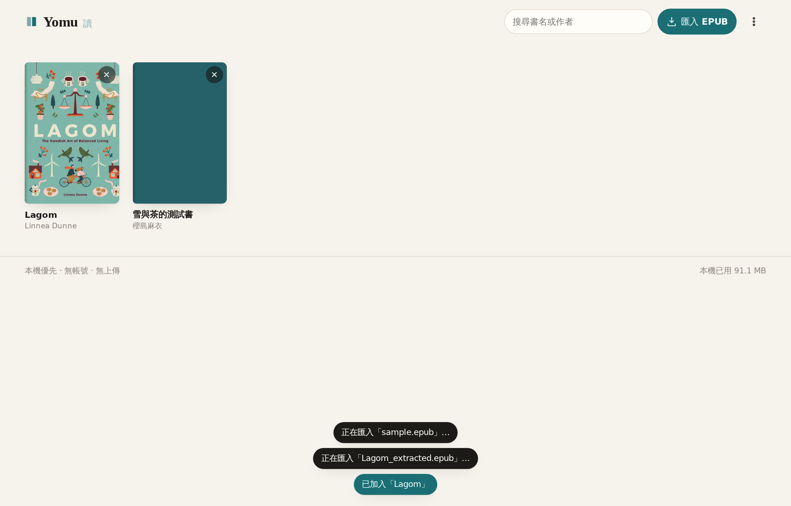

## What it does

- **Import by drag & drop or file picker** — **EPUB 2/3, MOBI, AZW3 (KF8), PDF, TXT and Markdown**, multiple at once.
- **Real reading experience** — chapter by chapter, with the book's own stylesheets, fonts and images preserved. Covers and inline images are resolved straight out of the file as `blob:` URLs. PDFs render through pdf.js with a real text layer, so selecting and highlighting works on scanned-looking pages too.
- **Highlights in four colours** — select any text and the toolbar appears. Marks survive reloads, chapter jumps and browser restarts.
- **Notes on any highlight** — click a mark to write, edit or delete it.
- **Highlights that actually stay put** — anchored by character offset plus the surrounding text, so a mark re-attaches even if the browser reflows the chapter. If a book's text genuinely changes, the record is kept rather than silently thrown away.
- **Table of contents** — EPUB 3 nav, EPUB 2 NCX, MOBI `filepos` links, and the PDF outline.
- **Reading position & progress** — remembered per book, shown on the shelf and in a "continue reading" strip.
- **One-tap dark mode** — a sun/moon button in both the library header and the reader bar. It always lands on an explicit theme, so it never *looks* broken just because your OS already agreed with it. The full picker also offers paper, and **auto** (follows the OS live).
- **Five UI languages — English, 繁體中文, 简体中文, 日本語, 한국어** — the app detects the browser language (including Simplified vs Traditional Chinese) and switches instantly from the settings drawer without reloading the open book. Generated labels follow too.
- **Organise your library** — make named shelves, file a book onto multiple shelves, filter with shelf chips, drag books onto a shelf, and sort by recently read / added / title / author. Shelves live in IndexedDB, are included in JSON backups, and deleting a shelf never deletes its books.
- **Reading settings** — font size, line height, column width, serif / sans / publisher font, themes, and a **full-width** layout that uses the whole screen (two columns on a desktop).
- **Fullscreen & immersive reading** — a native Fullscreen API button, and a Zen mode that hides the chrome so only the text is left. Tap the page, press `Z`, or `Esc` to get the toolbars back. On browsers without the Fullscreen API (iOS Safari) the button falls back to Zen instead of doing nothing.
- **Fits the device** — the reader sizes itself from `dvh`/`dvw` with safe-area insets, so a collapsing mobile URL bar or a notch never cuts text off; the column re-fits on rotation and resize, and PDF pages repaint at the new width.
- **Installable PWA** — works offline after the first visit. The app shell is cached by a service worker; the books themselves never need the network at all.
- **Backup that leaves the browser** — export every highlight and note as JSON (or as Markdown), and restore it later. Covers are deliberately excluded from the backup because they're regenerable from the file.
- **Storage-aware** — asks the browser for persistent storage on first import, and reports quota usage in the footer.

### Keyboard

| Key | Action |
| --- | --- |
| `←` / `→`, `PgUp` / `PgDn` | previous / next chapter (or PDF page) |
| `Z` | toggle Zen mode |
| `L` | cycle language (five supported locales) |
| `D` | toggle dark / light |
| `F` | open reading settings |
| `F11` | toggle fullscreen |
| `Esc` | close popover → drawer → Zen → fullscreen → back to library, in that order |

## Screenshots

| Reading | Highlights & notes | Dark |
| --- | --- | --- |
|  |  | 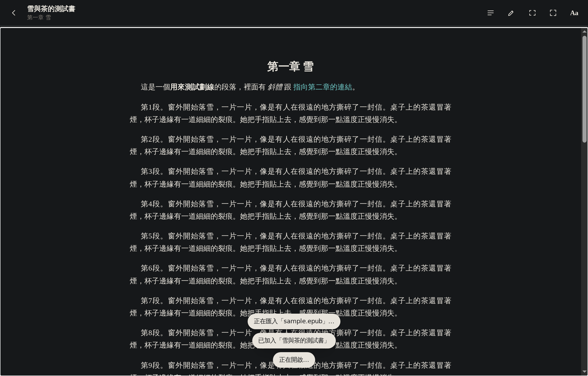 |

| Zen mode | Full-width (2 columns) | Settings |
| --- | --- | --- |
| 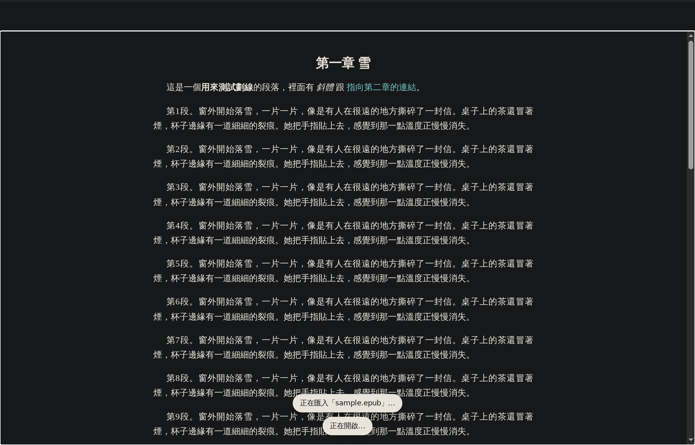 | 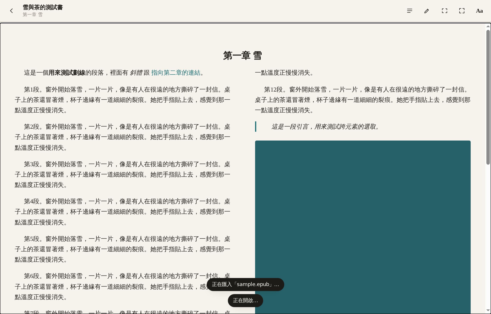 | 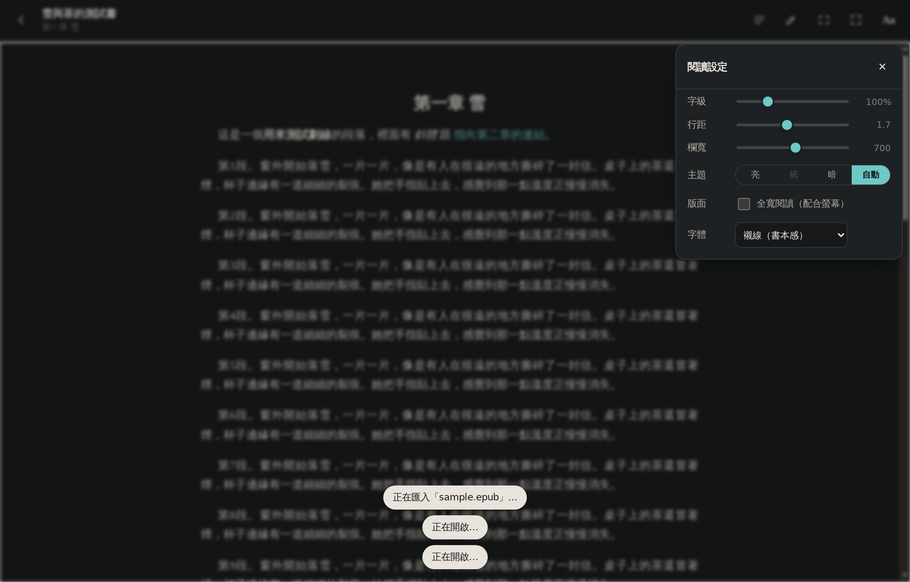 |

| Library (dark) | Phone, dark + Zen | Empty state |
| --- | --- | --- |
| 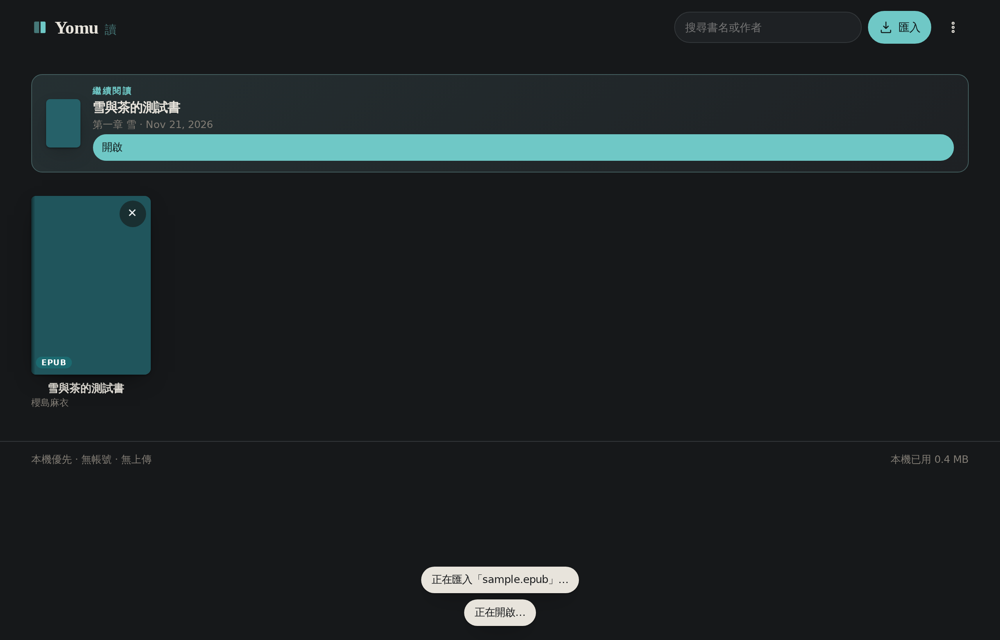 | 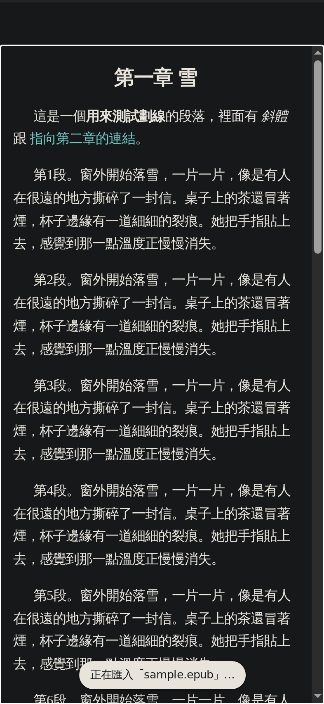 |  |

English UI:

| Library | Dark reader | Settings |
| --- | --- | --- |
| 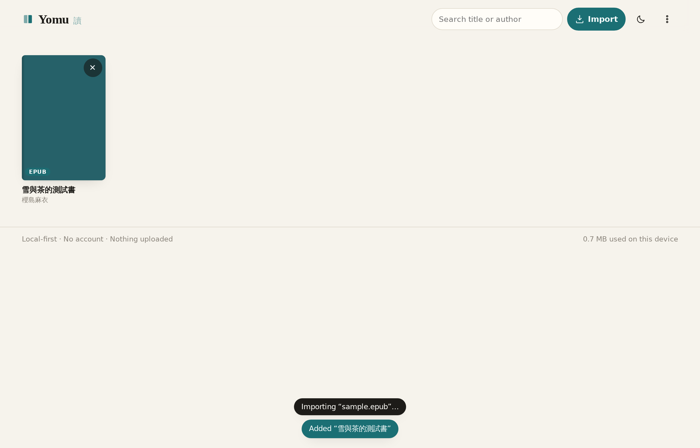 | 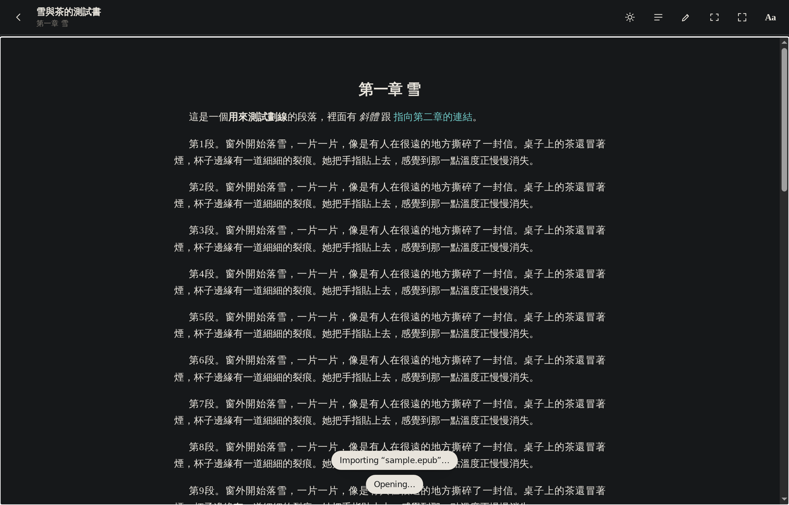 | 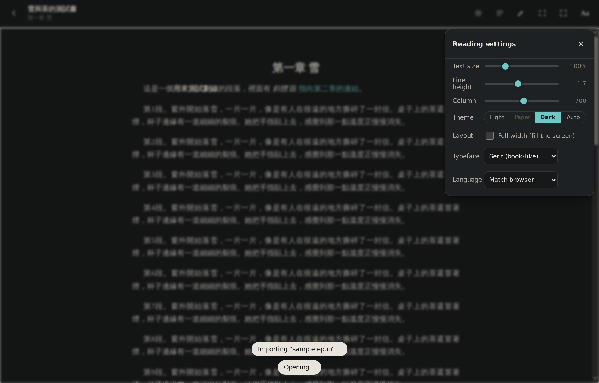 |

Shelves — a scrolling chip strip with a fixed new-shelf / sort cluster beside it, stuck under the header while you scroll:

| Desktop | Phone | Phone sort menu |
| --- | --- | --- |
| 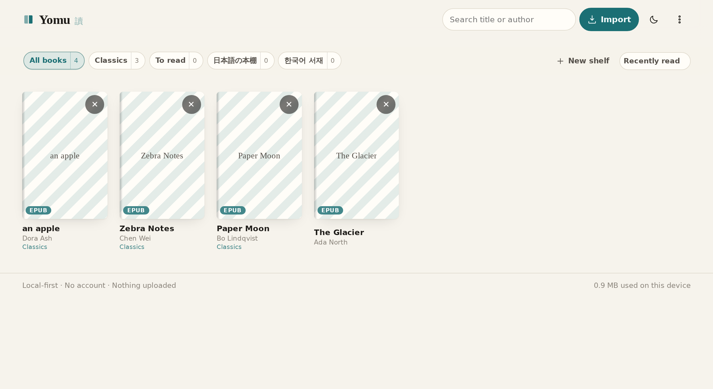 | 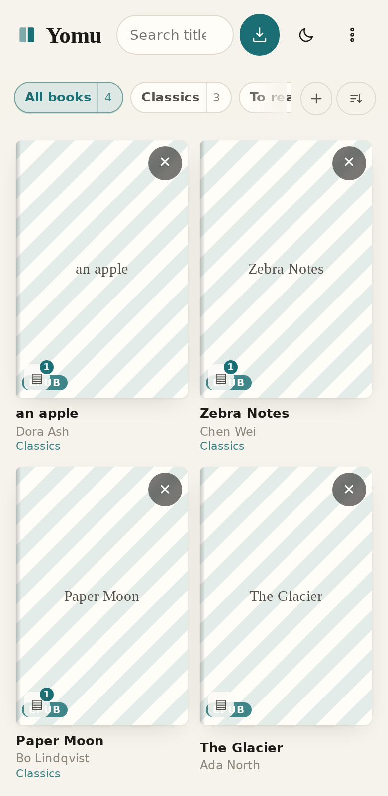 | 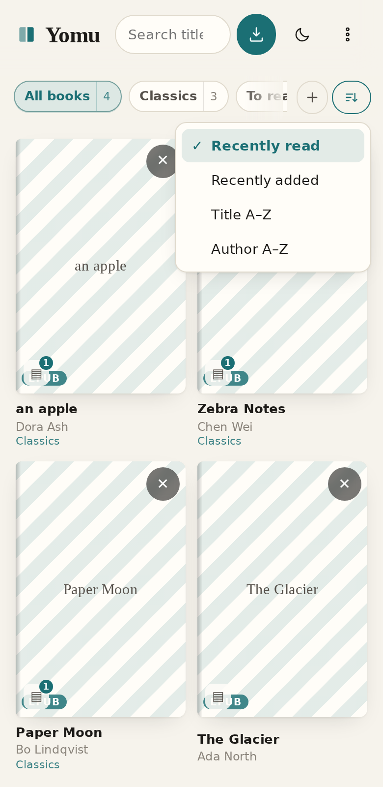 |

## Supported formats

| Format | Text | TOC | Images | Notes |
| --- | --- | --- | --- | --- |
| EPUB 2 / 3 | ✓ | nav or NCX | ✓ | full book CSS, fonts, covers |
| MOBI 7 | ✓ | guide → `filepos` | ✓ | PalmDOC + uncompressed |
| AZW3 / KF8 | ✓ | NCX | ✓ | via the vendored KF8 parser |
| PDF | ✓ text layer | outline | ✓ (rendered) | one chapter per page |
| TXT | ✓ | — | — | UTF-8/16, GB18030, cp1252 |
| Markdown | ✓ | — | — | safe subset, no raw HTML |

## How it works

There is no backend. Opening a book does this, in the tab:

1. The `.epub` is read as an `ArrayBuffer` and unzipped with [fflate](https://github.com/101arrowz/fflate) (only dependency, vendored — 33 KB).
2. `META-INF/container.xml` → the OPF → metadata, manifest, spine, and the TOC (nav doc or NCX).
3. For the current chapter only, the XHTML is parsed with `DOMParser`, stripped of scripts/handlers/`javascript:` URLs, its stylesheets inlined (with every `url()` rewritten to a `blob:` URL) and the result injected into the reader.
4. Highlights are stored as `{ chapter, start, end, text, prefix, suffix, color, note }`. The offsets index the chapter's concatenated text nodes; on re-render the code re-walks the DOM, verifies the text at those offsets, and falls back to searching for the stored snippet plus surrounding context.

Storage layout (IndexedDB `yomu`, v2):

| store | key | contents |
| --- | --- | --- |
| `books` | `id` | metadata + downscaled cover `Blob` |
| `files` | `id` | the raw `.epub` bytes |
| `highlights` | `id` (index `byBook`) | one row per highlight / note |
| `progress` | `bookId` | chapter index + ratio |
| `shelves` | `id` | named shelf metadata; book rows carry `shelves: [id, …]` |

Splitting bytes out of metadata keeps the shelf grid from ever touching a 90 MB blob.

## Run it locally

Any static file server works — the service worker needs `http://`, not `file://`:

```bash
python3 -m http.server 8811
# then open http://127.0.0.1:8811/
```

## Deploy

The repo is plain static files, so GitHub Pages serves it as-is:

```bash
git clone https://github.com/Hufung/yomu.git
cd yomu
# edit, commit, push to main — Pages redeploys automatically
```

## Privacy

Everything stays on the device. The only network requests the app ever makes are for its own files. There is no analytics, no fonts CDN, no remote API. Imported books are never sent anywhere; "backup" downloads a file to your machine.

## Languages and bookshelf

The settings drawer includes English, Traditional Chinese, Simplified Chinese, Japanese and Korean (plus automatic browser detection). Shelf names and book metadata are your own data, so the UI translation never rewrites them. Books can belong to multiple shelves; deleting a shelf only clears that shelf membership, never the underlying book file. Filter with the row of shelf chips, drag a cover onto a chip to file it quickly, use the per-book shelf button for multi-shelf membership, and sort the grid from the selector on the right.

The shelf bar is deliberately built so it cannot break as shelves accumulate: the strip is the only part that scrolls, it never wraps to a second row, chip names ellipsis while their counts stay whole, and the new-shelf / sort cluster is measured in JS so it can never be pushed off-screen. Under 560px the native sort `<select>` is swapped for a 40px button that opens a four-row popover — a native select needs ~120px, which is most of the strip's width on a phone, and it opens a full-screen picker anyway. It sticks directly under the library header (whose height is published as `--lib-head-h`, because it carries a safe-area inset CSS cannot read) and a right-edge fade appears only while more chips are off-screen.

## Limitations (honest list)

- **DRM-protected books are refused**, by design. EPUB font-obfuscation (`META-INF/encryption.xml` with only `FontObfuscation`) is allowed; content encryption is not. Kindle DRM .azw/.mobi files will not open.
- **No PDF reflow.** A PDF page is drawn as a page; text does not reflow to your font size. Fixed-layout EPUBs behave the same way.
- **HUFF/CDIC-compressed MOBI is not supported** — that format needs a dictionary table this reader does not implement. Convert with Calibre to EPUB or AZW3.
- **Browser storage can be evicted.** The app requests persistent storage, but a browser under pressure (or a "clear site data") can still discard books — export a backup if the notes matter.
- **Very large books are held in memory while open.** A 95 MB EPUB or a 96 MB MOBI opens in a couple of seconds here, but a 500 MB one will hurt.
- **Five UI languages are included** (English, Traditional Chinese, Simplified Chinese, Japanese, Korean). The string tables are in `js/i18n.js`; missing translations fall back to English.

## Built with

Vanilla JavaScript, no framework, no bundler.

- [fflate](js/vendor/fflate.LICENSE.txt) (MIT) — unzip
- [pdf.js](js/vendor/pdfjs/LICENSE) (Apache-2.0) — PDF rendering, vendored with its CMaps and standard fonts
- [@lingo-reader/mobi-parser](js/vendor/mobi/LICENSE-lingo-mobi) (MIT) — KF8/AZW3 only; MOBI 7 has a hand-written reader in `js/mobi7.js`
- [sax](js/vendor/mobi/LICENSE-sax), [events](js/vendor/mobi/LICENSE-events), [path-browserify](js/vendor/mobi/LICENSE-path-browserify) — dependencies of the KF8 parser

Testing was done with real Chromium over the DevTools protocol: EPUB lifecycle (39), format coverage, viewport/theme/fullscreen, five-locale switching, and a shelf suite covering the IndexedDB v1→v2 migration, sorting, drag/drop, backup, rename/delete. Run all suites with `../yomu-test/runall.sh`.

## License

MIT — see [LICENSE](LICENSE).
