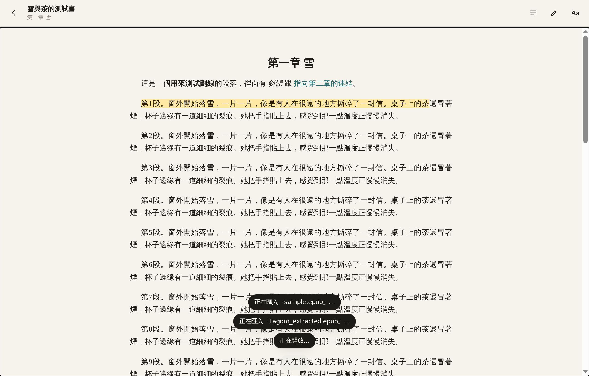
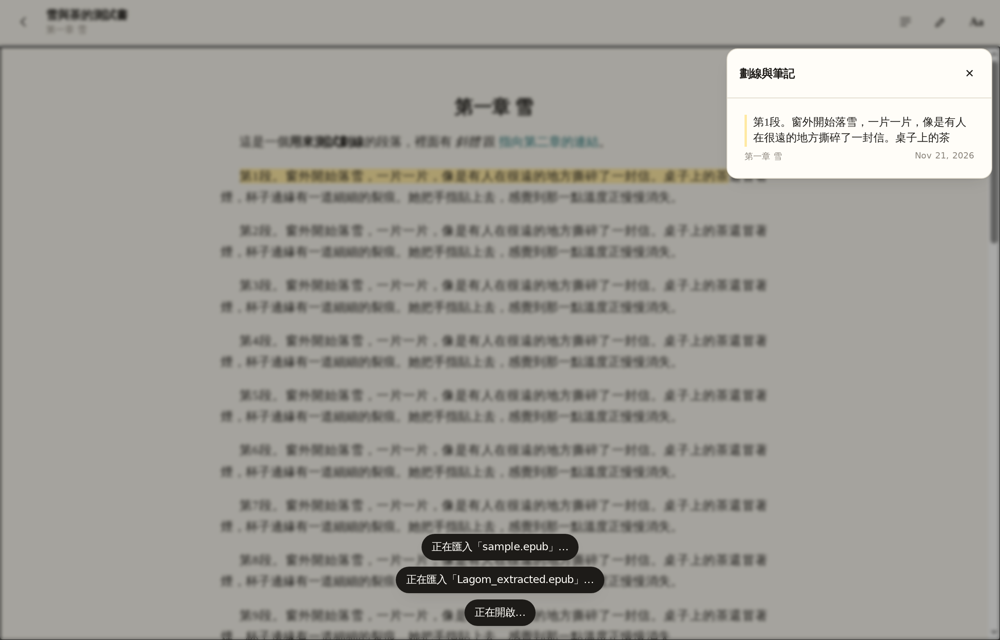
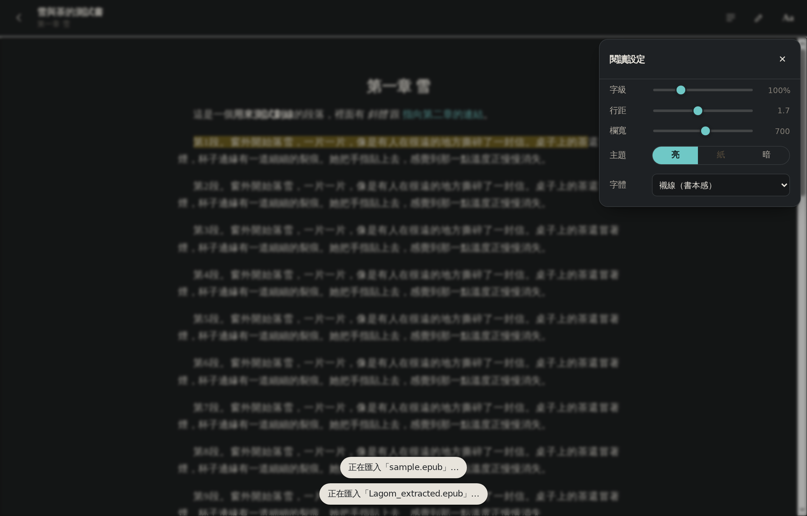
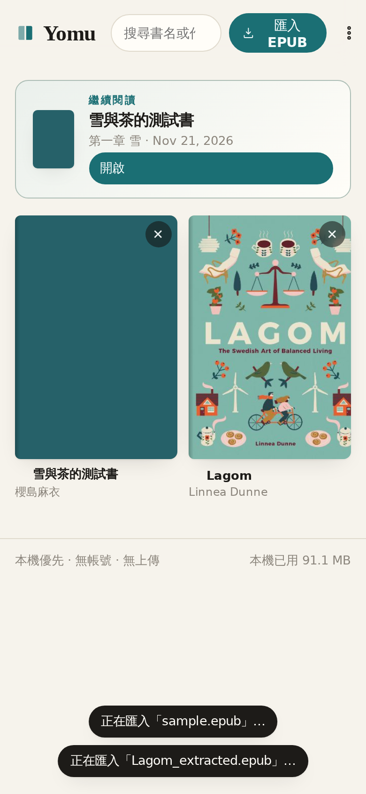

# Yomu — 読

A calm, local-first **EPUB reader that runs entirely in your browser**. Drop a book in, it lives in IndexedDB on your device, and every word, cover and highlight stays there. No account, no server, no upload, no tracking.

**[Open the app →](https://hufung.github.io/yomu/)**


## What it does

- **Import by drag & drop or file picker** — `.epub` (EPUB 2 and 3), multiple at once.
- **Real reading experience** — chapter by chapter, with the book's own stylesheets, fonts and images preserved. Covers and inline images are resolved straight out of the zip as `blob:` URLs.
- **Highlights in four colours** — select any text and the toolbar appears. Marks survive reloads, chapter jumps and browser restarts.
- **Notes on any highlight** — click a mark to write, edit or delete it.
- **Highlights that actually stay put** — anchored by character offset plus the surrounding text, so a mark re-attaches even if the browser reflows the chapter. If a book's text genuinely changes, the record is kept rather than silently thrown away.
- **Table of contents** — parsed from the EPUB 3 nav document, falling back to the EPUB 2 NCX.
- **Reading position & progress** — remembered per book, shown on the shelf and in a "continue reading" strip.
- **Reading settings** — font size, line height, column width, serif / sans / publisher font, and three themes (light, paper, dark). Saved to `localStorage`.
- **Installable PWA** — works offline after the first visit. The app shell is cached by a service worker; the books themselves never need the network at all.
- **Backup that leaves the browser** — export every highlight and note as JSON (or as Markdown), and restore it later. Covers are deliberately excluded from the backup because they're regenerable from the EPUB.
- **Storage-aware** — asks the browser for persistent storage on first import, and reports quota usage in the footer.

## Screenshots

| Reading | Highlights & notes | Dark |
| --- | --- | --- |
|  |  |  |

| Empty state | Phone |
| --- | --- |
|  |  |

## How it works

There is no backend. Opening a book does this, in the tab:

1. The `.epub` is read as an `ArrayBuffer` and unzipped with [fflate](https://github.com/101arrowz/fflate) (only dependency, vendored — 33 KB).
2. `META-INF/container.xml` → the OPF → metadata, manifest, spine, and the TOC (nav doc or NCX).
3. For the current chapter only, the XHTML is parsed with `DOMParser`, stripped of scripts/handlers/`javascript:` URLs, its stylesheets inlined (with every `url()` rewritten to a `blob:` URL) and the result injected into the reader.
4. Highlights are stored as `{ chapter, start, end, text, prefix, suffix, color, note }`. The offsets index the chapter's concatenated text nodes; on re-render the code re-walks the DOM, verifies the text at those offsets, and falls back to searching for the stored snippet plus surrounding context.

Storage layout (IndexedDB `yomu`, v1):

| store | key | contents |
| --- | --- | --- |
| `books` | `id` | metadata + downscaled cover `Blob` |
| `files` | `id` | the raw `.epub` bytes |
| `highlights` | `id` (index `byBook`) | one row per highlight / note |
| `progress` | `bookId` | chapter index + ratio |

Splitting bytes out of metadata keeps the shelf grid from ever touching a 90 MB blob.

## Run it locally

Any static file server works — the service worker needs `http://`, not `file://`:

```bash
python3 -m http.server 8811
# then open http://127.0.0.1:8811/
```

## Deploy

The repo is plain static files, so GitHub Pages serves it as-is:

```bash
git clone https://github.com/Hufung/yomu.git
cd yomu
# edit, commit, push to main — Pages redeploys automatically
```

## Privacy

Everything stays on the device. The only network requests the app ever makes are for its own files. There is no analytics, no fonts CDN, no remote API. Imported books are never sent anywhere; "backup" downloads a file to your machine.

## Limitations (honest list)

- **DRM-protected EPUBs are refused**, by design. Font-obfuscation (`META-INF/encryption.xml` with only `FontObfuscation`) is allowed; content encryption is not.
- **No PDF, MOBI, AZW3, CBZ.** EPUB only.
- **Browser storage can be evicted.** The app requests persistent storage, but a browser under pressure (or a "clear site data") can still discard books — export a backup if the notes matter.
- **Very large books are held in memory while open.** A 95 MB EPUB opens in ~1.5 s here, but a 500 MB one will hurt.
- **Fixed layout / pre-paginated EPUBs** are rendered as scrolling pages, not as true spreads.
- **The UI is in Traditional Chinese.** The reading surface follows the book's own language.

## Built with

Vanilla JavaScript, no framework, no bundler. [fflate](js/vendor/fflate.LICENSE.txt) (MIT) is the only third-party runtime code.

Testing was done with real Chromium over the DevTools protocol: 39 end-to-end assertions (import → read → highlight → note → restart → restore → settings → backup → service worker) plus a 95 MB / 150-chapter real book.

## License

MIT — see [LICENSE](LICENSE).
